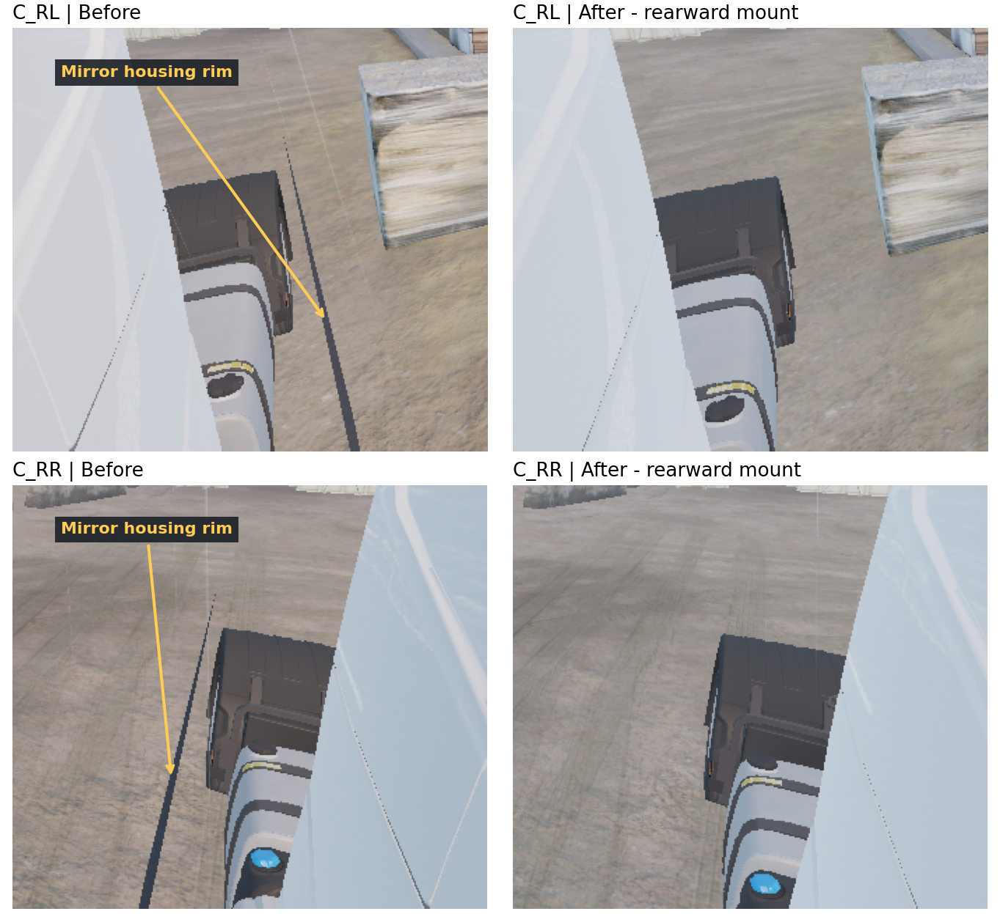

# 유로파일럿 — ETS2 자율주행 연구

ETS2의 FH4에 독립 카메라 4개와 깊이 기반 라이다 3개를 배치하고 Windows 네이티브 ROS 2 Jazzy로 실시간 발행합니다. IMU·바퀴·휠 오도메트리·가상 GNSS도 연결돼 있습니다. Phase 1 목표는 고속도로 ACC·차로 유지·사각지대 감시입니다. 상주 입력 장치와 core 0.30.0을 설치했고, 실제 지도 차로·GT 위치를 쓰는 속도 PI/경로 추종으로 FH4 약453m 자동 주행을 확인했습니다. 이 GT 주행은 연결 확인용 baseline으로 동결했고, 목표는 게임 GT 없이 센서만으로 달리는 것입니다. 진행 순서는 [Windows 네이티브 계획](docs/20_windows_native_port_plan.md)에 있습니다.

## 실행

1. Steam에서 **DirectX11 (64-bit)**로 게임을 실행합니다.
2. [apps/launch.cmd](apps/launch.cmd)를 열고 **시작**을 누릅니다.
3. Windows Foxglove에서 `ws://127.0.0.1:8765`로 연결합니다.

런처는 pixi 환경(`pixi run launcher`)에서 릴레이 노드·Foxglove 서버·GT 주행·기록을 함께 관리합니다. 중복 실행은 기존 창으로 돌아가며, 중지·창 닫기는 해당 실행의 프로세스를 정리합니다. 실행 시간과 센서 설정은 `bridge/config/bridge.local.json`을 공유합니다. 최초 설치(VS 2022 Build Tools, pixi)·빌드는 [브리지 사용법](bridge/README.md#최초-준비)에 있습니다. 릴레이만 띄우려면 `apps/launch.cmd --host-only`([사용법](apps/README.md)).

## 현재 상태 — 2026-10-12

| 구성 | 구현 |
| --- | --- |
| 게임 | ETS2 1.61.1.1, DX11, core/상주 loader 0.31.0(2026-10-12, W00 파서) |
| 운전 API | ✔ 0.31.0 loader가 custom modifier 프로필을 읽어 `profile_supported=true`, LB(`joy.b5`) 확인. Windows 네이티브 릴레이로 30 s armed 휴지 시험 통과, 명령 나이 p99 0.89 ms. 나머지 안전 시험은 [21](docs/21_safety_checklist.md) |
| 카메라 | C_FN·C_FW 1280×720, C_RL·C_RR 960×544, 기본 30 Hz 요청 |
| 배치 | FH4 4x2, stock 공통 캐빈·미러 외곽 기준의 캐빈 부착 |
| 출력 | RGB8, 미터 광축 깊이, CameraInfo, JPEG, TF, 차량 GT |
| 라이다 | 전방 1개·좌우 2개, 10 Hz GPU 깊이 샘플링, XYZ·range·결측 상태 |
| 추가 센서 | 이상적 IMU·바퀴 측정·휠 오도메트리·가상 GNSS, ROS 실제 수신 확인 |
| 전달 | 공유 GPU 텍스처·펜스 → 릴레이 노드(Windows C++, rclcpp)가 CDR을 직접 발행 → Fast DDS SHM. 중간 전송 프로세스 없음(2026-10-12, 게임 회귀 시험 전) |
| 조작 관측 | 운전자 입력·게임에 적용된 조향/페달·실제/표시 기어를 같은 SDK 프레임으로 발행 |
| 조작 명령 | GT 차로 생성·속도 PI·경로 추종·앞차 목표 제한(연결 확인용 baseline, 동결), 단일 owner·200 ms 만료·수동 개입 해제 |
| 기록 | 런처에서 차량 상태 / 영상·라이다 기록 시작·종료, MCAP 재생·일시정지 시계 정합 확인 |
| 복구 | 수집 소유권·lease, F11, 기능 DLL 교체, 연결 단절 복구 |

센서는 슬롯 3·4·6·7의 전용 camera/drawable과 출력을 사용합니다. 현재 FH4의 기본 미러 0·1·2·5는 유지됩니다. stock 캐빈·미러의 공통 외곽에서 장착점을 정하고 4뷰·라이다 3개 ROS 수신을 확인했습니다. 아래 이미지는 이전 FH5 장착 수정의 기록입니다.

0.26.1의 FH5 정차·60초 전경 실측은 JPEG 30 Hz·전체 라이다 10 Hz·GT 30 Hz에서 **62.46 FPS**, JPEG 10 Hz·표시용 라이다 10 Hz·같은 GT에서 **66.00 FPS**였습니다. Foxglove를 종료하고 실제 ROS 수신기를 사용했으며, 원본 RGB·depth 전송은 껐습니다. [측정 조건과 남은 비용](docs/18_performance.md).

평상시에는 필요한 인지용 축소 RGB와 JPEG·표시용 라이다를 구독합니다. JPEG 기본 주기는 10 Hz이며 인지용 영상은 카메라 주기를 따릅니다. Foxglove의 기존 점군 패널은 `/ets2/lidar/{name}/preview/points`를 선택해야 표시용 점군을 사용합니다. 원본 RGB·depth는 구독할 때 pack·readback·전송하며, 라이다용 깊이는 GPU에서 사용합니다.

상태 센서 계산·렌더 수집·ROS 직렬화·통신 수명을 분리했습니다. 영상 수집을 꺼도 IMU·휠·GNSS가 유지되고, TCP 재연결에도 오도메트리·가상 GNSS 기준점이 이어집니다. 런처의 **입력·상태만**으로 현재 SDK 바퀴 기준의 상태·입력을 실행할 수 있습니다. 센서 기본 프리셋은 FH4이며 다른 차량에는 해당 외형의 보정이 필요합니다. [런처 GT 자동 주행](bridge/README.md#gt-도로-자동-주행), [현재 구조](docs/03_system_design.md), [진행 이력](docs/legacy/13_game_operating_table.md).

## 소스와 실행 위치

| 위치 | 역할·실행 환경 |
| --- | --- |
| ot/ | Windows 게임 어댑터: 상주 loader, SDK 입력·관측, 엔진 hook, 센서 리그·GPU 자원, Python API |
| bridge/ | 릴레이 노드 소스(`windows/`)·토픽 표(`common/topics.hpp`), DDS·Foxglove 설정, 로컬 설정·기록 |
| [ros2/src](ros2/README.md) | 메시지·릴레이 노드·센서 열화·GT baseline 패키지. Windows pixi 환경에서 빌드·실행 |
| [apps/launcher](apps/launcher/README.md) | Windows UI, Job Object로 릴레이·Foxglove·GT 주행·기록 소유 |
| research/ | 분석 도구·원본 자료. 현재 지도 provider가 쓰는 로컬 .NET/TruckLib 의존성도 보존 |

편집 원본과 실행 환경은 Windows 저장소 하나입니다. ROS 빌드 결과는 `ros2/build·install·log`(Git 제외)에 둡니다. 인지·위치 추정·계획·FSM·고급 제어는 아직 구현하지 않았으며 다음 모듈 경계는 [시스템 구조](docs/03_system_design.md)와 [센서 스택 설계](docs/25_sensor_stack_design.md)에 정리했습니다.

## 문서

| 목적 | 문서 |
| --- | --- |
| 사용·설치 | [브리지와 런처](bridge/README.md), [DLL 개발 도구](ot/README.md) |
| 범위·결정 | [요구사항과 결정](docs/01_requirements_and_decisions.md) |
| 설계 | [구조](docs/03_system_design.md), [좌표·시각·데이터](docs/04_sensors_and_data.md), [FH4 센서 리그](docs/14_phase1_highway_sensors.md) |
| 센서·ROS | [라이다](docs/15_virtual_sensors.md), [ROS 토픽 계약](docs/16_ros2_bridge.md), [센서 확장](docs/17_sensor_expansion.md) |
| 다음 개발 | [Windows 네이티브 계획](docs/20_windows_native_port_plan.md), [성능 진단](docs/18_performance.md) |
| 포팅 상세 | [안전 체크리스트](docs/21_safety_checklist.md), [P0 실행서](docs/22_p0_spike_runbook.md), [릴레이 노드](docs/23_relay_node_design.md), [HUD 데칼](docs/24_hud_overlay_design.md), [센서 스택](docs/25_sensor_stack_design.md) |
| 레거시 | [옮긴 문서와 이유](docs/legacy/README.md): 마일스톤 표, Autoware adapter 계획, GT 폐루프 순서 |
| 엔진 참조 | [설치 분석](docs/10_installed_game_static_analysis.md), [SDK·물리 상태](docs/11_idle_memory_and_telemetry.md), [DX11·가시성](docs/12_dx11_mirror_render_path.md) |
| 시행착오 | [해결 과정과 재발 조건](docs/history/lessons.md) |

게임 파일·SDK 원본·추출 자산·기록·로컬 설정은 Git에서 제외합니다. 의존 코드와 라이선스는 [THIRD_PARTY](ot/THIRD_PARTY.md), 연구 도구는 [research](research/README.md)에 있습니다. 소용량 차량 상태 기록은 기본 `bridge/recordings/`, 영상·라이다 기록은 저장 공간을 확인해 지정한 폴더를 사용합니다.
