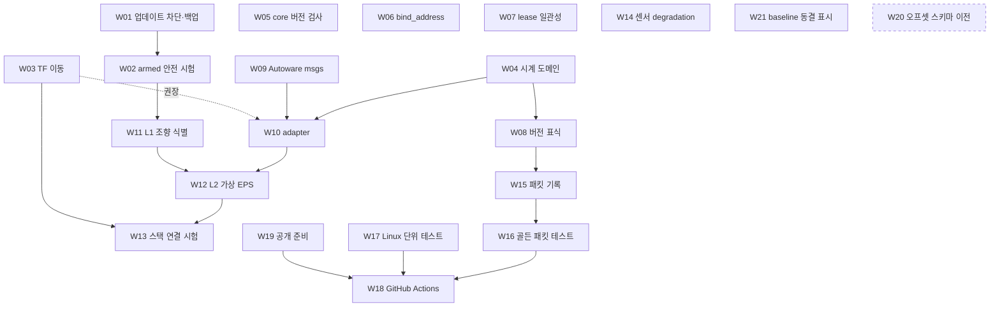

# 실차 스택 인터페이스 계획과 작업 목록

기준: `review-prep` 브랜치 커밋 `75bdf40`, 작업 트리 clean(2026-10-10). 아래 파일:줄은 이 커밋의 작업 트리에서 직접 확인한 값입니다. 이후 커밋이 쌓이면 줄 번호는 다시 확인해야 하며, 함수 이름과 식별자를 함께 적어 두었습니다.

표기: **✔** 코드·명령 출력에서 직접 확인한 사실, **△** 추론 또는 아직 확인하지 않은 가정. 다른 에이전트가 이 문서만 보고 순서대로 구현할 수 있도록 결정 기록 → 비범위 → 인터페이스 계약 → 작업 항목 → 의존 그래프 순서로 적습니다. 배경이 되는 구조는 [시스템 구조](03_system_design.md), [ROS 계약](16_ros2_bridge.md), [인지·제어](07_learning_and_control.md)에 있습니다.

## 1. 결정 기록

| ID | 질문 | 선택 | 이유 | 버린 대안 |
| --- | --- | --- | --- | --- |
| D1 | 목표 실차 스택 | **Autoware 계열 메시지만 계약으로 의존**. `autoware_control_msgs`, `autoware_vehicle_msgs`(필요 시 `autoware_common_msgs`)를 Jazzy apt 바이너리로 설치. 알고리즘 패키지는 필요할 때 패키지 단위로 그대로 의존하거나 포크해 경량화. Autoware launch·맵 서버 등 전체 스택은 비범위 | ✔ 2026-10-10 WSL `apt-cache policy`: `ros-jazzy-autoware-control-msgs 1.13.0`, `ros-jazzy-autoware-vehicle-msgs 1.13.0`, `ros-jazzy-autoware-common-msgs 1.13.0`, `ros-jazzy-ackermann-msgs 2.0.2` 후보 존재. `ros-jazzy-tier4-vehicle-msgs`는 후보 없음 → tier4 메시지는 쓰지 않음 | Autoware 전체 설치(비범위), 자체 메시지 정의(실차 정합 목적에 어긋남), ackermann_msgs 단독(가속도·모드 보고가 없음) |
| D2 | 조향 명령 의미 | **현재 프로필(`c_relatsteer=1`) 유지**. 상대 조향 입력을 "조향 회전 속도 지령"으로 쓰고, adapter 안에 가상 EPS(L2)를 두어 Autoware의 바퀴각 명령을 회전 속도로 바꾼다. L1 플랜트 식별 → L2 모델 → 스택 연결 순서. 절대 조향(L0 위치 제어)은 채택하지 않음 | 사용자 확인: controls.sii:339 mix steering에서 키보드·패드(joy.x)·semantical.steering이 합산되고 `c_relatsteer`는 프로필 전역이라 장치별 분리 불가. ETS2는 토크 입력·랙/셀프얼라이닝 토크 텔레메트리가 없음(Input SDK는 축 값만, FFB는 DirectInput 물리 장치로만). Real_G27_ffb 플러그인도 castor/kingpin 기하로 토크를 합성함. ✔ 네이티브는 조향을 [-1,1] 프로필 입력으로만 다루고 부호를 뒤집어 보냄(drive_control.hpp:41, manual_input.cpp:137) | ot_drive 전용 absolute mix(프로필 전역 설정이라 불가), 사용자 프로필 교체(패드 조작감 상실) |
| D3 | TF 소유권 | GT는 `world→gt/base_link`로 **항상** 발행(평가·RViz 비교). `world→base_link` 직접 발행은 `gt_localization_tf` 파라미터를 켰을 때만. 동적 TF는 렌더 묶음이 아니라 **상태 경로에서 SDK 프레임마다** 발행 | ✔ 현재 동적 `/tf`는 센서 묶음에만 실림(image_messages.cpp:111-113, 306). 카메라 구독이 없으면 TF가 없고, localization이 `odom→base_link`를 내면 base_link의 부모가 둘이 됨 | 렌더 묶음 TF 유지(카메라 의존), GT TF 완전 제거(평가 불편) |
| D4 | 네트워크 | **NAT + eth0 유지**. `bind_address`는 실제로 반영되게 정리(릴레이도 읽음). mirrored 전환은 비범위 | lessons.md 실측 eth0 6.1 Gbps vs localhost 0.55 Gbps. ✔ 릴레이는 `bind_address`를 읽지 않고 항상 `wsl_address()`를 씀(bridge/windows/main.cpp:106-107), ROS·launch는 읽음(ets2_bridge/src/main.cpp:93-94, bridge.launch.py:19-22) | mirrored networking(재측정 필요), bind_address 삭제(Linux 모드의 유연성 상실) |
| D5 | 라이선스·공개 | GitHub 공개. 루트 `LICENSE`는 **Apache-2.0**. `map_lane_provider`는 GPL-2.0 명시, 별도 프로세스 격리 유지. 서드파티 소스 배치는 D7. **기존 git 히스토리는 그대로 공개**(재작성하지 않음) | ✔ provider는 TruckLib를 `../../research/sources/...` 경로로 ProjectReference(map_lane_provider.csproj:9), research/sources는 gitignore. ✔ 2026-10-10 `git log -p --all`: 커밋 78개 중 사용자 로컬 절대경로(`C:\Users\<user>\...`) 14줄이 과거 research 스크립트에 남아 있고, `"token": "<16자 이상>"` 패턴은 0건. 사용자가 경로 노출을 수용 | 전체 GPL(릴레이·DLL까지 전염), provider 삭제(GT 차로 생성 수단 상실), filter-repo 히스토리 재작성(해시 전부 변경), 단일 커밋 새 공개 저장소 |
| D6 | CI | **GitHub Actions**. Linux 러너: colcon 빌드·단위 테스트·drive_control_test·골든 패킷 테스트. Windows 호스팅 러너: MSVC 빌드(ot_loader/ot_core/ets2_relay)·drive_control_test. 게임 내 시험은 수동 체크리스트. self-hosted 러너는 비범위 | ✔ 현재 CI 없음(`.github` 없음). ✔ Windows 빌드는 게임 EXE 존재(ot/CMakeLists.txt:31-33)와 SHA 일치(:44-47), `research/sdk/include`(:34-37), `fxc`(:53)를 요구 → 러너용 옵션이 필요(W18) | self-hosted 러너(비범위), Windows 빌드 CI 생략(컴파일 회귀를 못 잡음) |
| D7 | 서드파티 소스 배치(공개 저장소) | **(a)** SCS SDK 1.15 헤더는 `ot/vendor/scs_sdk/`에 vendoring(라이선스 파일 포함). **(b)** TruckLib·TruckLib.HashFs는 `third_party/` 아래 git submodule로 고정 commit. **(c)** 나머지 참고 소스(ETS2LA, SPF 등)는 저장소에 넣지 않고 `SOURCES.md`의 고정 revision 표를 유지, 필요 시 `research/fetch_sources.py`로 내려받음. **(d)** dotnet10·PresentMon·RenderDoc·scs_packer는 계속 제외, CI는 `actions/setup-dotnet` 사용 | ✔ SDK 라이선스는 MIT형 허가(research/sdk/sdk_license.txt: use, copy, modify, distribute 허용, 고지 유지 조건). ✔ TruckLib는 GPL-2.0이라 submodule이 출처·버전·라이선스 보존에 가장 명확. ✔ SOURCES.md에 revision 표 존재 | 모든 소스 submodule(저장소 비대, 라이선스 혼재), SDK URL 다운로드만(오프라인 빌드 불가, 단 CI 대안으로는 허용) |
| D8 | M9 GT ACC/LCC | **연결 확인용 baseline으로 동결**. 추종 오차·overshoot 개선은 하지 않음. 런처의 GT 주행 버튼은 유지 | 목표가 실차 스택이면 이 알고리즘은 대체됨 | M9 개선 지속 |
| D9 | 최우선 순서 | **W01(게임 자동 업데이트 차단·백업)과 W02(armed 안전 시험)를 가장 먼저** | 업데이트 한 번에 14 RVA·시그니처·오프셋이 무효가 되고, 안전 해제는 로직 테스트만 통과한 상태 | 인터페이스 작업 먼저 |

## 2. 비범위(non-goals)

이번 계획에서 하지 않는 것입니다. 각 항목은 "다시 검토할 시점"을 함께 적었습니다.

- DX12 추상화 계층. 재검토: SCS가 Windows DX12 렌더러를 제공할 때.
- rmw_zenoh·iceoryx·Windows 직접 DDS 발행·NVENC·GPU JPEG. 재검토: 인지 추론을 올린 뒤 게임 p99 프레임 시간이 센서 주기를 못 맞출 때.
- 카메라·라이다 ID 동적화, 토픽 목록 일반화. 재검토: ATS 이식 또는 두 번째 차량 프리셋.
- 하드코딩 오프셋의 전면 스키마 이전, 긴 main 함수 리팩터. 재검토: 다음 게임 업데이트(W20으로 보류).
- GT ACC/LCC 알고리즘 개선, 휠 오도메트리 304.58 m 오차 수정(원인만 기록). 재검토: 스택 localization 연결 때 공분산 모델이 필요하면.
- BEV/E2E, 시내·교차로·주차, 멀티 트럭, ext4 체크아웃 이전, WSL mirrored networking, self-hosted CI 러너, Autoware 전체 설치, tier4 메시지.
- 센서 영상 잡음(GPU 측). 재검토: W14 상태 센서 잡음 뒤.

## 3. 인터페이스 계약

### 3.1 네임스페이스와 소유권

| 네임스페이스 | 생산자 | 성격 |
| --- | --- | --- |
| `/ets2/*` | Windows 릴레이 → ets2_bridge | 시뮬레이터 전용. 이상(ideal) 측정, GT, 운전 API, 진단. 메시지 스키마는 유지 |
| `/sensing/*` | `ets2_sensor_degradation`(W14) 또는 remap(W10 launch) | 스택이 보는 센서. 잡음·지연·드롭 적용 후 |
| `/vehicle/status/*`, `/control/command/*` | `ets2_vehicle_interface`(W10) | 실차 vehicle interface와 같은 메시지 |
| `/tf`, `/tf_static` | 릴레이(정적·GT·cabin), 스택 localization(`map→odom→base_link`) | D3 |

### 3.2 adapter 토픽·서비스(W10)

QoS 표기: R=reliable, BE=best-effort, TL=transient-local, Kn=KeepLast(n). ✔ Autoware 1.13.0 메시지 필드는 2026-10-10 `apt-get download`로 받은 .deb의 .msg/.srv에서 직접 대조했습니다(설치 없이). 부호 규약: `Lateral`·`SteeringReport`는 왼쪽 +, SDK `truck.wheel.steering`도 반시계(왼쪽) +라 변환 없이 맞습니다. `Control`·`Lateral`·`Longitudinal`·`SteeringReport`·`ControlModeReport`·`GearReport`는 `builtin_interfaces/Time stamp`, `VelocityReport`·`Actuation*Stamped`만 `std_msgs/Header`를 씁니다.

| 방향 | 토픽/서비스 | 타입 | QoS | 주기 | adapter 처리 |
| --- | --- | --- | --- | --- | --- |
| 스택→adapter | `/control/command/control_cmd` | `autoware_control_msgs/msg/Control` | BE K1 | 스택 주기(기본 50 Hz 가정) | `lateral.steering_tire_angle`[rad], `lateral.steering_tire_rotation_rate`[rad/s](✔ `is_defined_steering_tire_rotation_rate`가 true일 때만 사용) → L2 EPS → 상대 조향 입력. `longitudinal.velocity`[m/s], `longitudinal.acceleration`[m/s²](✔ `is_defined_acceleration`이 true일 때만 feedforward) → 종방향 맵 → throttle/brake. `jerk`는 무시 |
| 스택→adapter | `/control/command/gear_cmd` | `autoware_vehicle_msgs/msg/GearCommand` | R K1 TL | 이벤트 | Phase 1: DRIVE/NEUTRAL만 수용, 그 외 거절 로그. 게임 기어는 자동 변속 가정(△ 수동 변속 프로필은 비범위) |
| 스택→adapter | `/control/control_mode_request` | `autoware_vehicle_msgs/srv/ControlModeCommand` | 서비스 | 이벤트 | 아래 3.3 매핑으로 `/ets2/drive/control` arm/disarm |
| 스택→adapter | `/vehicle/emergency` (선택) | `std_msgs/msg/Bool` △(tier4 메시지 미사용) | R K1 | 이벤트 | true → 즉시 disarm + brake 1.0 한 프레임 전송 후 해제 |
| adapter→스택 | `/vehicle/status/velocity_report` | `autoware_vehicle_msgs/msg/VelocityReport` | R K1 | SDK 프레임마다(≈ 게임 FPS, ✔ VehicleState는 frame_id 변화마다 전송 bridge/windows/main.cpp:147-149) | `longitudinal_velocity`=VehicleState.velocity_base_mps[0], `lateral_velocity`=[1], `heading_rate`=angular_velocity_base_radps[2], `header.frame_id`=`base_link` |
| adapter→스택 | `/vehicle/status/steering_report` | `autoware_vehicle_msgs/msg/SteeringReport` | R K1 | WheelState마다 | `steering_tire_angle`=조향축 좌우 바퀴 `steering_angle_rad` 평균(✔ WheelState는 SDK `truck.wheel.steering`을 rad로 변환, motion_sensors.cpp:46-51). 모델 추정값이 아니라 실측 |
| adapter→스택 | `/vehicle/status/control_mode` | `autoware_vehicle_msgs/msg/ControlModeReport` | R K1 | DriveState마다 | 3.3 매핑 |
| adapter→스택 | `/vehicle/status/gear_status` | `autoware_vehicle_msgs/msg/GearReport` | R K1 | ActuationState마다 | `engine_gear>0`→DRIVE, `==0`→NEUTRAL, `<0`→REVERSE, `engine_gear_available=false`→NONE |
| adapter→스택 | `/vehicle/status/actuation_status` | `autoware_vehicle_msgs/msg/ActuationReportStamped` | R K1 | ActuationState마다 | ✔ 1.13에 포함(tier4 불필요). `accel_report`=throttle applied, `brake_report`=brake applied, `steer_report`=applied 정규화 조향[-1,1]. 모두 게임이 실제 적용한 값이며 명령 복사가 아님 |
| adapter 내부 | `/ets2/drive/control`, `/ets2/drive/command`, `/ets2/drive/state`, `/ets2/vehicle/state`, `/ets2/vehicle/actuation`, `/ets2/wheels/state` | 기존 | 기존(✔ wire.hpp:135-141, ets2_bridge main.cpp:102-105) | | 기존 운전 API를 감싼다 |

### 3.3 ControlMode·축 매핑과 watchdog

| 스택 요청(ControlModeCommand.mode) | adapter 동작 | DriveControl.axes | 보고(ControlModeReport.mode) |
| --- | --- | --- | --- |
| AUTONOMOUS | arm axes=3 | 3 | AUTONOMOUS (DriveState.armed && axes==3) |
| AUTONOMOUS_STEER_ONLY | arm axes=1 | 1 | AUTONOMOUS_STEER_ONLY (axes==1) |
| AUTONOMOUS_VELOCITY_ONLY | arm axes=2 | 2 | AUTONOMOUS_VELOCITY_ONLY (axes==2) |
| MANUAL | disarm(epoch 명시) | 0 | MANUAL (armed==false) |
| (스택 요청 없는 강제 해제) | DriveState.reason ∈ {manual, expired, paused, panic, disconnected, input_unavailable} → `/diagnostics` ERROR에 reason 문자열 | 0 | **DISENGAGED** |
| (스택의 MANUAL 요청 뒤 정상 해제) | reason = disarmed | 0 | MANUAL |
| (준비 안 됨) | DriveState.available/permitted/profile_supported 중 false, 또는 reason ∈ {profile_unsupported, disabled} | | NOT_READY |

✔ 상수 값(ControlModeReport): NO_COMMAND=0, AUTONOMOUS=1, AUTONOMOUS_STEER_ONLY=2, AUTONOMOUS_VELOCITY_ONLY=3, MANUAL=4, DISENGAGED=5, NOT_READY=6. ControlModeCommand.srv는 0–4만 있고 응답은 `bool success`입니다. 강제 해제를 `DISENGAGED`로 보고하는 것은 이 문서의 선택입니다. 스택이 "운전자 개입·만료·패닉"과 "요청한 수동 전환"을 구분할 수 있게 하기 위함이며, 둘 다 AUTONOMOUS가 아니므로 Autoware의 자율 활성 판단에는 차이가 없습니다(△ Autoware 제어 쪽이 DISENGAGED를 특별 취급하는지는 W13에서 확인).

✔ 축 비트는 steering=1, pedals=2(DriveControl.srv, drive_api.hpp를 통해 core.cpp:359-361에서 검사). ✔ 사람이 소유 축을 건드리면 다음 입력 프레임에 해제(drive_control.hpp:39-40). ✔ 상태 `axes=0`은 해제(DriveState.msg 주석).

watchdog(모두 adapter 안, ROS steady clock):

| 조건 | 동작 |
| --- | --- |
| `control_cmd` 수신 간격 > 200 ms | 명령 발행 중단 → 코어가 200 ms 뒤 `expired`로 해제(✔ drive_control.hpp:49). adapter는 즉시 disarm 요청도 보냄 |
| `/ets2/drive/state` 또는 `/ets2/vehicle/state` 수신 간격 > 200 ms | 명령 발행 중단, MANUAL 보고 |
| DriveState.epoch/owner가 adapter 것과 다름 | 재arm 하지 않음(✔ 정책: resume/reconnect는 자동 재arm 없음, docs/03). 스택이 다시 ControlModeCommand를 보내야 함 |
| 명령 발행 | 50 Hz 고정, `sequence` 단조 증가, 마지막 스택 명령을 hold(최대 200 ms) |

시계: `/clock`과 모든 센서 stamp는 `paused_simulation_time_us`(✔ state_messages.cpp:62-64, image_messages.cpp:93). adapter·watchdog은 steady clock. 명령 유효창은 W04 이후 릴레이가 부여하므로 ROS 쪽에 Windows 시계값이 남지 않음.

### 3.4 프레임

| 프레임 | 생산자 | 비고 |
| --- | --- | --- |
| `world` | 릴레이 | GT 기준. `[SCS X, -SCS Z, SCS Y]` m |
| `world→gt/base_link` | 릴레이, 상태 경로, 항상(W03) | ego pose GT |
| `world→base_link` | 릴레이, 상태 경로, `gt_localization_tf=true`일 때만(W03) | 스택 localization 없이 돌릴 때 |
| `base_link→cabin` | 릴레이(W03 본문 참조) | 카메라·라이다 부모 |
| `cabin→<camera>_optical`, `cabin→<lidar>`, `base_link→imu_link/gnss_link` | 릴레이 `/tf_static`(✔ state_messages.cpp:35-53) | 유지 |
| `wheel_odom→base_link` | 발행 안 함(토픽만) | 유지(✔ state_messages.cpp:17) |
| `map`, `odom` | 스택 localization | 시뮬레이터는 만들지 않음 |

## 4. 작업 항목

형식: **ID 제목** / 목표 / 변경 파일:줄 / 선행 / 완료 기준 / 게임 실행 필요. 규모 S(반나절 이하), M(1~3일), L(그 이상).

### P0. 보전과 안전

**W01 게임 자동 업데이트 차단과 1.61.1.1 백업** (S)
- 목표: 분석된 EXE가 Steam 업데이트로 바뀌지 않게 한다.
- 변경: 코드 없음. ot/README.md "게임 업데이트" 절에 절차 추가. Steam 라이브러리 → 속성 → 업데이트 "이 게임을 실행할 때만 업데이트" + 설치 폴더 전체를 다른 드라이브에 복사.
- 선행: 없음.
- 완료 기준: 복사본 `bin/win_x64/eurotrucks2.exe`의 SHA256이 ot/schema/1.61.1.1/game.json의 `exe_sha256`(✔ `2014bfcc…5199a`)과 같음. 절차가 문서에 있음.
- 게임 실행: 아니오(게임 종료 상태에서 수행).

**W02 armed 상태 게임 내 안전 시험과 bag 보존** (S, 최우선)
- 목표: 로직 테스트(ot/native/drive_control_test.cpp, ✔ WSL g++ 13 + ASan/UBSan 통과)만 거친 해제 경로를 실제 게임에서 확인한다.
- 변경: 새 문서 `docs/20_safety_checklist.md`(표 형식 체크리스트, 실행 일자·core 버전·결과·bag 경로). 코드 변경 없음. 기록은 런처의 "차량 상태" 프로필로 충분(✔ apps/launcher/bag_recording.py:16-21 STATE_TOPICS에 `/ets2/drive/state`, `/ets2/drive/command` 포함).
- 선행: W01 권장.
- 시험 목록과 기대 결과(✔ 코드 근거):

| # | 조작 | 기대 DriveState.reason | 근거 |
| --- | --- | --- | --- |
| 1 | LCC armed 중 패드 좌우 조작 | `manual`, axes→0, 출력 3축 0 | drive_control.hpp:40, manual_input.cpp:91-99 |
| 2 | ACC armed 중 RT/LT 또는 W/S | `manual` | 동일 |
| 3 | ACC만 armed 중 조향 조작 | 유지(해제 없음) | drive_control.hpp:40의 `manual_axes_&axes_` |
| 4 | F11 | `panic`, lease 취소, Tier 0 | input_device.cpp:50,54; core.cpp:153-162 |
| 5 | ESC pause | `paused`; resume 후 재arm 없음 | drive_control.hpp:44; loader.cpp:97-98 |
| 6 | 제어 노드 정지(`kill -STOP`) | 200 ms 내 `expired` | drive_control.hpp:49 |
| 7 | 릴레이 종료 | `disconnected` | core.cpp:343, bridge/windows/main.cpp:104 |
| 8 | 패드 USB 분리 | `input_unavailable` | input_device.cpp:43 |

- 완료 기준: 8개 모두 기대 reason으로 전이하고 ActuationState의 applied 값이 다음 SDK 프레임부터 사람 입력을 따름. 각 시험의 bag 경로가 체크리스트에 기록됨. 실패 항목은 docs/08에 등록.
- 게임 실행: 예.

### P1. 계약 정리(Windows 빌드 필요, 검증은 게임)

**W03 동적 TF를 상태 경로로 이동, GT TF 분리** (M)
- 목표: D3. 카메라 구독과 무관하게 SDK 프레임마다 `world→gt/base_link`를 발행하고, `world→base_link`는 옵션으로 한다.
- 변경:
  - bridge/windows/state_messages.cpp:96-101 `state_messages()`의 ego pose 블록 옆에 `/tf` 메시지 추가: `world→gt/base_link` 항상, `world→base_link`는 설정 `gt_localization_tf`(bridge.local.json, 기본 false)일 때.
  - bridge/common/wire.hpp:148 `{"/tf","tf2_msgs/msg/TFMessage"}`를 상태 토픽(state=true)으로 바꾸고, ros2/src/ets2_bridge/src/main.cpp:117의 "토픽-소켓 일치" 검사가 `/tf`에 대해 양쪽 소켓을 허용하도록 예외 처리(묶음 경로의 cabin TF가 남는 경우).
  - `base_link→cabin`은 **묶음 경로에 그대로 둔다**. bridge/windows/image_messages.cpp:111에서 `world→base_link` 줄만 제거하고 :112-113의 cabin TF는 유지한다. 이유(✔): 현재 cabin 자세는 렌더된 카메라 자세에서 역산하므로(image_messages.cpp:103-106) 영상과 TF가 같은 렌더 프레임 기준으로 일치한다. SDK 채널로 옮기면 이 일치가 깨질 수 있고, SDK 채널은 `truck.cabin.offset`(fplacement 하나, 기본 위치 대비 변화량, scssdk_telemetry_truck_common_channels.h:78)이라 config `cabin.position`(scssdk_telemetry_common_configs.h:397)도 함께 필요하다. cabin TF가 필요한 쪽은 카메라·라이다 소비자이므로 묶음 경로 의존은 문제가 되지 않는다. (정정: 이전 판의 `truck.cabin.offset.position/orientation` 채널명과 "euler 타입 추가"는 틀렸다.)
  - 묶음 경로의 cabin TF는 `world→base_link`가 꺼진 상태(`gt_localization_tf=false`)에서도 `base_link`를 부모로 발행한다. 이때 `base_link`의 부모는 스택 localization(`odom→base_link`)이다.
  - docs/16_ros2_bridge.md, docs/04_sensors_and_data.md의 TF 설명 갱신.
- 선행: 없음(W08과 같은 파일을 건드리므로 순서만 조정).
- 완료 기준: `slots: []`·카메라 미구독에서 `ros2 run tf2_ros tf2_echo world gt/base_link`가 SDK 주기로 갱신. `gt_localization_tf=false`에서 `world→base_link` 없음, true에서 있음. `ros2 run tf2_tools view_frames`에서 base_link 부모가 하나. 센서 묶음 bag(런처 "센서" 프로필)에서 카메라 TF 체인이 끊기지 않음.
- 게임 실행: 예(검증). 빌드: MSVC.

**W04 명령 시계 도메인 정리** (S)
- 목표: ROS 노드가 Windows monotonic 값을 복사하는 구조를 없애고 DBW heartbeat 패턴으로 맞춘다.
- 변경:
  - ros2/src/ets2_msgs/msg/DriveCommand.msg:6-7 `command_window_ms` 제거(msgs 버전 올림, W08). **`uint64 sent_steady_ns` 필수 추가**: 발행 노드의 `std::chrono::steady_clock`(Linux CLOCK_MONOTONIC, 같은 WSL 안의 프로세스끼리 공유) 값.
  - ros2/src/ets2_bridge/src/main.cpp:75-76 `deadline_ms` 전달 제거. 같은 콜백에서 `now_steady - sent_steady_ns`가 `max_command_age_ms`(파라미터, 기본 50) 초과이거나 음수면 릴레이로 보내지 않고 버린다. 이유(✔): 릴레이가 수신 시점에 유효창을 붙이면 WSL 쪽에서 늦게 도착한 명령도 200 ms의 새 수명을 얻는다. ets2_bridge는 최신 명령 하나만 보관하므로(main.cpp:75 덮어쓰기) 피해는 1개로 제한되지만, 이전 설계의 종단 간 신선도 보장을 이 검사로 유지한다. 남는 구간은 WSL→Windows 로컬 TCP 한 홉뿐이다.
  - bridge/windows/main.cpp:131-136 `drive_request` 변환에서 action==command일 때 `request["deadline_ms"]=ticks()+200` 부여. ✔ `ticks()`는 GetTickCount64(bridge/windows/windows_support.hpp:22)이고 코어 검사도 GetTickCount64(input_device.cpp:22,52)라 같은 시계. ✔ 코어 조건 `deadline_ms<=now || deadline_ms>now+200`(drive_control.hpp:28)은 그대로 통과.
  - ros2/src/ets2_autonomy/src/gt_drive_node.cpp:171 `command_window_ms` 복사 제거(동결 baseline이지만 빌드 유지에 필요).
  - DriveState.msg의 `command_window_ms`는 진단용으로 유지하거나 제거(제거 시 state_messages.cpp:89 함께).
  - bridge/README.md "운전 명령 API"의 유효창 설명 갱신.
- 선행: 없음.
- 완료 기준: drive_control_test 변경 없이 통과(코어 의미 불변). 게임에서 50 Hz DriveCommand(window 없음, `sent_steady_ns` 채움)로 arm→active 유지, 발행 중단 후 ≤ 250 ms에 `expired`. 같은 sequence 재전송은 거절(DriveState.sequence 불변). `sent_steady_ns`를 100 ms 과거로 넣은 명령은 ets2_bridge에서 버려지고 DriveState.sequence가 변하지 않음. `ros2 topic pub`은 `sent_steady_ns`를 채울 수 없으므로 시험용 발행 스크립트를 쓴다.
- 게임 실행: 예(검증).

**W05 릴레이의 core 버전 확인을 명시적 최소 버전 검사로** (S)
- 목표: ✔ state_source.cpp:10이 StateSource 생성자에서 pipe `version` 왕복을 하므로, `version` 명령이 없는 구 core에서는 `game_ipc.cpp:32`가 `{"ok":false}` 응답을 예외로 바꿔 릴레이가 시작 즉시 종료되며 원인 메시지가 불명확하다. 또 pipe 타임아웃(game_ipc.cpp:6,20: 3 s)이 생성자 안에서 발생한다.
- 변경: bridge/windows/main.cpp:101 `owned({{"cmd","tier"},{"value",1}})` **앞**(lease 획득 직후, 첫 mutating 명령 전)에서 `version`을 한 번 호출해 `plugin_version`을 `minimum_core_version`(상수, 0.29.0)과 비교하고, 실패 시 "설치된 core <버전>은 version 명령 또는 최소 버전을 만족하지 않습니다. ot/README.md의 DLL 교체 절차를 따르세요"로 종료. StateSource는 받은 값을 인자로 받도록 바꿔 생성자 안의 pipe 호출 제거(state_source.cpp:7-11, state_source.hpp).
- 선행: 없음.
- 완료 기준: 현재 core 0.29.0에서 릴레이 정상 시작. 코드 리뷰로 구 core 경로의 메시지 확인(△ 구 core 실물 시험은 생략 가능). 런처 상태창에 그 메시지가 그대로 표시됨(✔ launcher.py:308-330 `_observe`가 릴레이 stdout을 읽음).
- 게임 실행: 예(정상 경로 확인).

**W06 `bind_address`를 릴레이에도 반영** (S)
- 목표: D4. 설정 한 곳이 양쪽에 같은 의미로 적용되게 한다.
- 변경: bridge/windows/main.cpp:106 `wsl_address(...)` 앞에 `config.value("bind_address","")`가 비어 있지 않으면 그 주소를 사용. bridge/configure.py의 기본 설정에 `bind_address: ""` 키와 주석 추가. apps/README.md의 bind_address 설명이 실제 동작과 일치하게 수정.
- 선행: 없음.
- 완료 기준: `bind_address`를 WSL eth0 IP로 명시 → 연결됨. 존재하지 않는 IP로 설정 → 릴레이 "Cannot connect to WSL <ip>:<port>", ROS "Cannot listen on <ip>:<port>" 두 메시지 모두 설정값을 포함.
- 게임 실행: 예(릴레이는 연결 전에 lease를 잡음, ✔ main.cpp:96-101).

**W07 lease 없는 mutating 명령 차단** (S)
- 목표: 안전 모델을 문서(docs/03 "lease가 내부 읽기·리그·수집을 소유")와 일치시킨다. ✔ `require_owner`는 lease가 있거나 요청에 owner가 있을 때만 검사한다(ot/native/core.cpp:309-312). 따라서 lease 없이 `tier`, `render_probe`, `camera_rig`, `stream`을 바꿀 수 있다(△ stream은 require_owner만 거침).
- 변경: core.cpp:309-312 `require_owner`를 "lease가 비어 있으면 거절"로 바꾸고, 읽기 전용 명령(`ping`, `version`, `status` 류, `snapshot`, `state`, `drive status`)은 호출하지 않음을 확인. ot/py의 `ot.cmd` 서브커맨드 중 lease 없이 mutating 명령을 보내는 경로가 있으면 lease claim을 추가(△ 목록은 ot/py 확인 필요). docs/03 설명 유지.
- 선행: 없음.
- 완료 기준: `ot.cmd tier 1`(lease 없음) → 거절 메시지. 런처 전체 모드와 `ot.cmd preview`는 기존처럼 동작. 패닉 뒤 재활성화 거절 동작 유지(✔ docs/18 확인 항목).
- 게임 실행: 예.

**W08 버전 표식** (S)
- 목표: 릴레이·ROS·메시지 불일치를 역직렬화 실패 전에 잡는다. ✔ 현재 wire 버전 표식은 `OTR1` 매직뿐(bridge/common/wire.hpp:107-121).
- 변경: wire.hpp에 `constexpr int wire_schema_version`; 릴레이 hello 패킷(bridge/windows/main.cpp:108)에 `wire_version` 추가; ets2_bridge main.cpp:151 pairing 검사에 버전 불일치 거절 추가; `/ets2/sensors/config`에 `wire_version`, `msgs_version` 추가(state_source.cpp:9-11); ros2/src/ets2_msgs/package.xml:3 버전을 0.2.0으로 올리고 "메시지 변경 시 올린다" 규칙을 ros2/README.md에 기록; 머지 후 `git tag v0.29.0`.
- 선행: W04(메시지 변경과 함께 버전 올림).
- 완료 기준: 릴레이 `wire_version`을 일부러 바꾸면 pairing 거절 메시지에 두 버전이 찍힘. W16 골든 패킷 테스트가 hello 검증을 포함.
- 게임 실행: 예(릴레이 실행). ROS 쪽 검사는 W16으로 Linux에서 재검증.

### P2. 스택 인터페이스(adapter)

**W09 Autoware 메시지 의존성 도입과 결정 기록** (S)
- 목표: D1.
- 변경: WSL에 `ros-jazzy-autoware-control-msgs`, `ros-jazzy-autoware-vehicle-msgs` 설치(✔ 후보 1.13.0). 새 패키지 `ros2/src/ets2_vehicle_interface/package.xml`에 `<depend>` 추가. `docs/19`(이 문서) 4.1 표에 패키지별 "그대로 의존/포크" 결정과 의존 트리(`apt-cache depends ros-jazzy-autoware-control-msgs`) 기록. CI apt 목록(W18)에 추가.
- 선행: 없음.
- 완료 기준: `ros2 interface show autoware_control_msgs/msg/Control`, `autoware_vehicle_msgs/msg/ControlModeReport`, `SteeringReport`, `VelocityReport`, `GearReport`, `srv/ControlModeCommand`의 필드가 3.2·3.3 표와 맞음(불일치는 표를 갱신). colcon 빌드 통과.
- 게임 실행: 아니오.
- 진행(2026-10-10): 필드 대조와 4.1 의존 트리는 .deb 압축 해제로 완료(✔, 3.2·3.3·4.1 갱신). WSL 설치는 sudo 비밀번호가 필요해 사용자가 `sudo apt install ros-jazzy-autoware-control-msgs ros-jazzy-autoware-vehicle-msgs`를 실행해야 함. colcon 빌드 확인은 W10 패키지와 함께.

4.1 의존성 결정표(W09에서 채움):

| 패키지 | 용도 | 결정 | 의존 트리 확인 |
| --- | --- | --- | --- |
| autoware_control_msgs 1.13.0 | Control 명령 | 그대로 의존(apt) | ✔ builtin_interfaces·rosidl 런타임뿐 |
| autoware_vehicle_msgs 1.13.0 | 보고·모드 서비스·ActuationReport | 그대로 의존(apt) | ✔ std_msgs, autoware_planning_msgs(→ autoware_common_msgs, geometry_msgs, nav_msgs, unique_identifier_msgs). 패키지 수준 의존일 뿐 vehicle 메시지 필드는 planning 타입을 쓰지 않음. 모두 메시지 패키지라 가벼움 |
| autoware_common_msgs 1.13.0 | 직접 쓰지 않음 | 간접 설치만 | ✔ 위 트리로 함께 설치 |
| autoware_simple_pure_pursuit | W13 횡방향 소비자 후보 | W13에서 apt 그대로 시험, 의존이 과하면 자체 최소 구현 | ✔ Jazzy apt에 존재. 의존 트리 △ |
| autoware_vehicle_velocity_converter, autoware_gyro_odometer, autoware_ekf_localizer | 스택 localization(VelocityReport+IMU → twist → EKF) | 비범위(스택 localization 연결 때 검토) | ✔ Jazzy apt에 존재 |
| autoware_velocity_smoother | 종방향 목표 평활 | 필요할 때 검토 | ✔ Jazzy apt에 존재 |
| raw_vehicle_cmd_converter(가속도→페달 맵) | 종방향 맵 | Jazzy apt에 없음(✔ `apt-cache search` 결과 부재) → W10 adapter 안에 자체 구현, CSV 맵 형식은 Autoware와 맞춰 나중에 교체 가능하게 | — |

**W10 `ets2_vehicle_interface` adapter 노드** (M)
- 목표: 3.2·3.3 계약 구현. 종방향 먼저, 횡방향은 W12 전까지 "interim" 모드.
- 변경: 새 패키지 `ros2/src/ets2_vehicle_interface/`(C++ 또는 Python, 50 Hz 타이머). 구성 요소:
  - 모드 서비스 서버 → `/ets2/drive/control` 클라이언트(축 매핑 3.3).
  - 명령 변환: 종방향 `acceleration`+`velocity` → throttle/brake. 초기 맵은 속도 PI + 가속도 feedforward 상수(✔ gt_drive_node.cpp:183-190의 PI 구조를 참고하되 복사하지 않고 adapter 소유 코드로), 파라미터 파일 `config/longitudinal.yaml`. 횡방향: `lateral_mode` 파라미터 `interim_position_pi`(✔ gt_drive_node.cpp:174-182와 같은 applied-steering 추종 PI, `steering_tire_angle`을 `steering_angle_per_unit_rad`로 정규화) → W12에서 `virtual_eps`로 교체·interim 삭제.
  - 보고 발행 5종, watchdog 3.3, `/diagnostics`.
  - `launch/sim_stack.launch.py`: adapter + 센서 remap(`/ets2/camera/<id>/perception/image_raw`→`/sensing/camera/<id>/image_raw` 등) + `/tf_static` alias(`<camera>_optical`→`camera_<id>/camera_optical_link`, identity).
- 선행: W04(유효창 제거), W09. W03 권장.
- 완료 기준: Linux 단위 테스트(rclcpp 없이 변환 함수만): 모드 매핑 표 전수, watchdog 타임아웃, 종방향 맵 단조성. 통합(게임): `ros2 service call /control/control_mode_request ... AUTONOMOUS_VELOCITY_ONLY` 후 `control_cmd velocity=8.33` 발행으로 FH4가 30 km/h ±1 km/h 유지(정차 출발 포함). 명령 중단 → ≤ 250 ms에 `control_mode=MANUAL`. 패드 개입 → 다음 DriveState에서 MANUAL.
- 게임 실행: 통합 시험만 예.

**W11 L1 조향 플랜트 식별** (M)
- 목표: 상대 조향 입력 → `truck.effective.steering` 변화율 → 바퀴각의 이득·포화·불감대·지연·차속 의존·`c_rsteersens` 영향을 수치로 확보한다.
- 변경: 새 노드 `ets2_autonomy/steering_identification`(LCC만 arm, axes=1). 상대 조향은 적분기이므로(△ 입력 0이면 위치 유지, 입력 크기가 회전 속도) 한 방향 step을 유지하면 바퀴가 끝까지 꺾여 위험하고 포화 구간 데이터만 남는다. 입력 시퀀스: (1) **doublet**: 같은 크기·같은 길이의 +u, −u 펄스 쌍(u = 0.1, 0.3, 0.6, 펄스 길이는 차속별 바퀴각 상한에서 역산)으로 순 조향각을 0으로 되돌린다. (2) 저이득 위치 유지 루프(applied steering → 0) 위에 얹은 chirp(0.1–2 Hz, 진폭 0.2)와 ramp. 유지 루프 출력도 함께 기록해 식별 입력에 포함한다. 차속은 게임 크루즈 컨트롤로 사람이 유지(10/30/50/70 km/h) 또는 W10 ACC. 기록 토픽: `/ets2/drive/state`(command·applied), `/ets2/vehicle/actuation`(input/effective), `/ets2/wheels/state`(바퀴각), `/ets2/vehicle/state`(속도·yaw rate), `/clock`. 분석 스크립트 `tools/steering_identify.py`(Linux, rosbag2 MCAP 읽기): (1) `d(effective)/dt ≈ K(v)·sat(u − deadzone)` 적합과 지연, (2) effective → 조향축 바퀴각 정적 맵과 1차 지연, (3) `c_rsteersens` 값과 프로필 파일 해시 기록. 출력 `config/steering_plant.yaml`.
- 안전: W02 통과 후, 교통 없는 직선 고속도로(`uset g_traffic 0`), 진폭은 차속별 상한, 사람이 패드를 잡고 감독.
- 선행: W02. W04 권장.
- 완료 기준: 각 차속에서 2회 독립 run. 모델 예측 effective steering의 RMSE가 신호 진폭의 10% 이하(△ 제안 임계치, 결과를 보고 조정), run 간 파라미터 편차 15% 이하. bag·스크립트·yaml·보고서(`docs/21_steering_plant.md`)가 저장소에 남음.
- 게임 실행: 예.

**W12 L2 가상 EPS와 조향 계통 모델** (M)
- 목표: Autoware `steering_tire_angle`(+`rotation_rate`)을 상대 조향 입력으로 바꾸는 물리 기반 변환. 충실도 한계를 문서에 명시한다.
- 변경: `ets2_vehicle_interface/src/virtual_eps.*`: 목표 바퀴각 → (W11 정적 맵 역변환) 목표 컬럼 각 → EPS 토크 제어(PD + feedforward, 토크 한계) → 조향 계통 `J θ̈ + c θ̇ + 마찰/백래시 + τ_align = τ_eps` → θ̇ → (W11 이득 역변환) 상대 입력. `τ_align`은 실측 횡가속도(IMU)·yaw rate·차속과 castor/kingpin 기하로 합성(Real_G27_ffb 파라미터를 출발점으로, △ 값은 트럭별 보정 필요). `config/virtual_eps.yaml`. `lateral_mode=virtual_eps` 기본, interim 삭제. 문서: "게임 타이어 모델이 아닌 합성 토크"임을 docs/07과 이 문서에 명시. SteeringReport는 모델이 아니라 실측 바퀴각(3.2).
- 선행: W10, W11.
- 완료 기준: Linux 단위 테스트: W11 적합 플랜트를 시뮬레이션해 step 목표 0.05 rad에 정상상태 오차 < 5%, 오버슈트 < 20%(△ 제안치). 게임: 같은 step에서 SteeringReport 응답 기록, 지연·오버슈트가 단위 테스트의 2배 이내. 30 km/h·50 km/h에서 실행.
- 게임 실행: 예.

**W13 스택 연결 시험** (M)
- 목표: 실차와 같은 메시지만으로 폐루프가 도는지 확인한다.
- 변경: 최소 소비자 노드(autoware 메시지만 사용, `ets2_msgs` 미의존)로 pure pursuit + 속도 제어를 구현하거나 Autoware 제어 패키지를 4.1 표의 결정대로 가져온다. GT 차로 JSON(map_lane_provider)과 `world→base_link`(`gt_localization_tf=true`)를 입력으로 같은 약 453 m 구간 주행.
- 선행: W03, W10, W12.
- 완료 기준: ControlModeReport 전이(MANUAL→AUTONOMOUS→MANUAL)가 요청과 해제 사유에 맞음. 패드 개입 → 1 SDK 프레임 내 MANUAL. 차로 중심 오차 p95를 보고서에 기록(목표치 없음, baseline 비교용).
- 게임 실행: 예.

### P3. 센서 충실도

**W14 `ets2_sensor_degradation` 노드** (M)
- 목표: 잡음·지연·드롭을 ROS 쪽에서, seed 고정으로, bag 재생에도 적용 가능하게 한다. ✔ 현재 잡음 모델 없음(`model:"ideal"`, motion_sensors.cpp:215; 공분산 0, state_messages.cpp:18-19,25-26,31).
- 변경: 새 패키지 `ros2/src/ets2_sensor_degradation/`: `/ets2/imu/data_raw`→`/sensing/imu/imu_raw`(백색잡음·바이어스 랜덤워크·축 정렬·공분산 채움), `/ets2/gnss/fix`→`/sensing/gnss/nav_sat_fix`(시간 상관 오차·지연·드롭아웃·status 전환), `/ets2/wheels/*`→`/sensing/wheels/*`(양자화·반지름 오차), `/ets2/lidar/*/points`→`/sensing/lidar/*/points`(거리 잡음·결측 확률). 파라미터 `seed`, 토픽별 `latency_ms`, `drop_probability`. 영상은 pass-through(비범위).
- 선행: 없음(현 토픽으로 동작). W10 launch와 remap 정합.
- 완료 기준: Linux 단위 테스트: 같은 seed → 같은 출력, 설정 분산 대비 표본 분산 ±10%, 지연 설정이 stamp 차이로 확인됨. bag 재생에서 동작.
- 게임 실행: 아니오.

### P4. 테스트·CI·공개

**W15 릴레이 패킷 기록 옵션** (S)
- 목표: W16의 고정 입력을 만든다.
- 변경: bridge/windows/main.cpp에 `--record-packets <dir>` 옵션: `state_send`(main.cpp:125)와 bulk 송신(main.cpp:188)이 보내는 바이트를 각각 `state.otr`, `bulk.otr`에 그대로 추가 기록(hello 포함). 테스트 전용 token을 bridge.local.json에 설정해 기록. 기록 크기 제한(예: 상태 10 s, 묶음 3개).
- 선행: W08(hello에 wire_version 포함 후 기록).
- 완료 기준: 기록 파일을 W16 하네스가 그대로 재생해 ets2_bridge가 pairing·발행에 성공. 고정 입력은 Git LFS 또는 GitHub Release asset으로 보관(저장소 직접 커밋은 상태 파일 < 1 MB만).
- 게임 실행: 예(한 번).

**W16 골든 패킷 테스트(Linux)** (M)
- 목표: ets2_bridge를 게임·Windows 없이 검증한다.
- 변경: `ros2/src/ets2_bridge/test/golden_packets.py`(launch_testing): ets2_bridge를 테스트 config(token=기록 token, bind_address=127.0.0.1)로 띄우고, 하네스가 릴레이 역할로 17401/17400에 연결해 `state.otr`/`bulk.otr`를 재생. rclpy 구독으로 `/clock`, `/ets2/vehicle/state`, `/ets2/imu/data_raw`, `/ets2/camera/C_FN/preview/image/compressed`, `/ets2/lidar/L_F/points`, `/tf_static` 수신 수와 역직렬화 성공 확인. 역방향 demand 패킷(✔ ets2_bridge main.cpp:183-186) 형식 검사. 잘못된 token·wire_version 거절 케이스.
- 선행: W15. ets2_bridge main.cpp:93-94 ✔ `bind_address` 지원으로 127.0.0.1 바인드 가능.
- 완료 기준: `colcon test --packages-select ets2_bridge` 통과(WSL과 GitHub Linux 러너).
- 게임 실행: 아니오.

**W17 Linux 단위 테스트 분리** (S)
- 목표: 플랫폼 독립 코드를 Linux에서 검증한다.
- 변경: bridge/common/wire.hpp 프레이밍(send/receive_header 왕복, 한계값), bridge/windows/motion_sensors.cpp(△ 포함 헤더는 telemetry/geometry/vehicle_profile/mount_layout로 Win32 비의존으로 보임, 빌드로 확인)의 IMU·휠 오도메트리 수식에 대한 ctest. `bridge/tests/CMakeLists.txt`(Linux에서만 구성; ✔ bridge/CMakeLists.txt:5-7은 non-Windows를 FATAL_ERROR로 막으므로 별도 디렉터리로).
- 선행: 없음.
- 완료 기준: `ctest`가 WSL과 Linux 러너에서 통과. drive_control_test도 같은 ctest에 포함(`-fsanitize=address,undefined`).
- 게임 실행: 아니오.
- 진행(2026-10-10): ✔ 완료(WSL). 위치는 `bridge/tests`가 아니라 저장소 루트 `tests/`입니다. drive_control_test가 ot 코드라 bridge 아래에 두지 않았습니다. `cmake -S tests -B /tmp/ets2-portable-tests && cmake --build /tmp/ets2-portable-tests && ctest --test-dir /tmp/ets2-portable-tests` → 3/3 통과(g++ 13.3, ASan/UBSan). `wire_test`: socketpair 왕복, 잘못된 매직·메타·blob 크기 거절, 끊긴 연결의 TransportError, 토픽 이름 중복 없음. `motion_sensors_test`: 직진·Ackermann 선회 오도메트리(정확한 호와 비교), 공중 바퀴 제외, pause 구간 미적분, 정지 IMU +g, 왼쪽 yaw 양수, GNSS 10 Hz 유지·model +x=동쪽, 차량 세대 변경 거절. 중력 부호·yaw 부호·회전→rad 변환·GNSS 주기·호 중간점 적분 5개 변이를 모두 잡는 것을 확인했습니다. drive_control_test는 controls.sii 경로 인자 없이 실행하므로 ManualInput 검사는 CI에서 빠집니다(사용자 프로필을 저장소에 넣지 않음).

**W18 GitHub Actions** (M)
- 목표: D6.
- 변경:
  - `.github/workflows/linux.yml`(ubuntu-24.04): ROS apt 소스, `ros-jazzy-ros-base`, `ros-jazzy-autoware-control-msgs`, `ros-jazzy-autoware-vehicle-msgs`, `ros-jazzy-vision-msgs`, `ros-jazzy-rosbag2-storage-mcap`, `nlohmann-json3-dev`, rosdep → `colcon build` → `colcon test`(W16) → W17 ctest → drive_control_test.
  - `.github/workflows/windows.yml`(windows-2022 호스팅): ✔ 저장소 빌드는 VS 18 BuildTools 기준이고 러너는 VS 17(2022)이므로 `/std:c++latest`로 C++23 호환 여부를 첫 실행에서 확인(△). ot/CMakeLists.txt에 옵션 `OT_REQUIRE_GAME_EXE`(기본 ON): OFF이면 :31-33 EXE 탐색과 :44-47 SHA 비교를 건너뛰고 game.json의 해시만 build_identity에 넣는다(런타임 SHA 게이트는 그대로, ✔ core.cpp:103-106). SCS SDK는 D7(a) vendoring 또는 `scs_sdk_1_15.zip` 다운로드 + SHA256 `77504f14…28ec`(✔ research/README.md) 검증 후 `-DSCS_SDK=`. `fxc.exe`는 Windows Kits bin을 PATH에 추가(△ 러너 이미지 확인). bridge는 FetchContent Fast-CDR(✔ bridge/CMakeLists.txt:11) 그대로. map_lane_provider는 D7(b) submodule 체크아웃 + `actions/setup-dotnet` 10.x로 빌드. drive_control_test를 MSVC로 빌드·실행.
  - 게임 내 시험은 `docs/20_safety_checklist.md`를 "수동 게이트"로 PR 템플릿에 링크.
- 선행: W16, W17(없어도 빌드 단계는 먼저 올릴 수 있음), D7 결정 반영(W19).
- 완료 기준: main에 push 시 두 워크플로 녹색. Windows 워크플로가 ot_loader.dll·ot_core.dll·ets2_relay.exe를 artifact로 올림.
- 게임 실행: 아니오.

**W19 공개 준비(라이선스·서드파티·비밀값)** (M)
- 목표: D5, D7.
- 변경: 루트 `LICENSE`(Apache-2.0), `NOTICE`, ot/THIRD_PARTY.md에 SCS SDK vendoring 항목 추가. `third_party/TruckLib`, `third_party/TruckLib.HashFs` submodule(고정 commit `c42dbe4f…`, `5e33031d…`), bridge/map_lane_provider/map_lane_provider.csproj:9 경로 변경, bridge/map_lane_provider/README.md 빌드 절차 갱신, GPL-2.0 고지 유지. `research/fetch_sources.py`(SOURCES.md 표의 revision을 내려받는 스크립트). `.gitignore`에 `bridge/config/bridge.local.json`을 명시(✔ 현재 미추적이지만 명시 규칙이 없음), pre-commit 또는 CI에 토큰 패턴 검사. `ot/vendor/scs_sdk/`로 헤더 이동 후 ot/CMakeLists.txt:34 기본 `SCS_SDK` 경로 변경.
- 선행: 없음.
- 완료 기준: 새 clone + submodule init만으로 Linux CI 통과, Windows CI는 W18 옵션으로 통과. 작업 트리와 W19 이후 커밋에 토큰·절대경로 없음(✔ 75bdf40에서 작업 트리의 절대경로 제거). 기존 히스토리의 사용자 경로 14줄은 D5에 따라 수용한다. 공개 직전 `git log -p --all`에 토큰 패턴 검사를 한 번 더 실행한다.
- 게임 실행: 아니오.

### P5. 보류(트리거가 생기면 수행)

**W20 하드코딩 오프셋의 스키마 이전** (M, 트리거: 다음 게임 업데이트 또는 ATS 이식)
- 변경 대상(✔): ot/native/camera_rig.cpp:28,135,257(`0x36AE6D8`), :207(`0x87fd70`) 및 :24-44,153-157,164,198,206-207,236,246-259의 구조체 오프셋; ot/native/pass_commands.cpp:380-396,426-434(`0x304FC50+b*0x2A8` 등); ot/native/render_probe.cpp:14-48(14개 RVA·시그니처), :344-345, :427-428, :491-499. 모두 ot/schema/<version>/fields.json으로 옮기고 `evidence` 필드를 채운다.
- 완료 기준: `grep -nE "0x[0-9A-Fa-f]{5,}" ot/native/*.cpp`가 스키마 로더 외에서 비어 있음. 새 스키마로 docs/ot README "게임 업데이트" 절의 확인 순서 통과.
- 게임 실행: 예.

**W21 baseline 동결 표시** (S)
- 변경: README.md 현재 상태 표, docs/07, docs/13 M9 행에 "연결 확인용 baseline, 알고리즘 개선 없음(D8)" 명시. ros2/src/ets2_autonomy/package.xml description에 동일 문구.
- 선행: 없음. 완료 기준: 문서 링크 검사 통과. 게임 실행: 아니오.

## 5. 작업 순서와 의존 그래프

병렬 가능 묶음(같은 묶음 안은 서로 독립):

| 단계 | 병렬 가능 | 비고 |
| --- | --- | --- |
| 0 | W01, W21 | 즉시. W01은 게임 종료 상태 |
| 1 | W02 ‖ W05 ‖ W06 ‖ W07 ‖ W09 ‖ W14 ‖ W17 ‖ W19 | W02만 게임 필요. W05·W06은 bridge/windows/main.cpp를 함께 건드리므로 한 브랜치에서 순서대로 |
| 2 | W03 ‖ W04 | 둘 다 state_messages.cpp 또는 msgs를 건드림. 게임 검증은 한 세션에 묶어서 |
| 3 | W08 → W15 → W16 ‖ W10 ‖ W11 | W10은 W04·W09 뒤. W11은 W02 뒤(게임) |
| 4 | W12 → W13 ‖ W18 | W18은 W16·W17·W19 뒤 |
| 보류 | W20 | 게임 업데이트 또는 ATS 때 |

게임 실행이 필요한 항목은 W02, W03(검증), W04(검증), W05(정상 경로), W06, W07, W08(릴레이), W10(통합), W11, W12(게임 단계), W13, W15, W20입니다. 나머지는 WSL과 CI에서 끝납니다.

## 6. 이 문서가 정정하는 이전 인용

- 아키텍처 리뷰에서 수요→출력 매핑을 `render_capture.cpp:86-106`으로 인용했으나 실제 위치는 `bridge/windows/render_capture.cpp:4-24`(`capture_outputs`)이고 hook·stream 해제는 `:33-54`입니다(✔). 파일은 55줄입니다.
- 이 문서의 첫 판(2026-10-10)을 실행 전 검토하며 바로잡은 항목(✔ 코드 대조): W03 cabin TF 방식(SDK 채널명·타입 오류, 렌더 일치 근거), W04 명령 신선도 보장(`sent_steady_ns` 필수화와 ets2_bridge 나이 검사), W05 버전 검사 위치(첫 mutating 명령 앞), W11 입력 설계(적분기 플랜트에 doublet과 유지 루프 사용), W19 히스토리 완료 기준(D5), 3.3 `DISENGAGED` 확인 항목.
