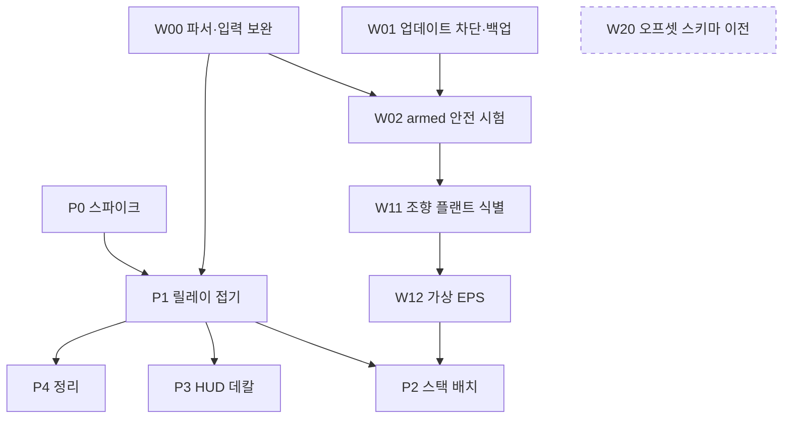

# Windows 네이티브 포팅 계획

기준: `review-prep` 커밋 `9abe299`와 작업 트리, 2026-10-12(2차 개정). 결정 근거는 [요구사항과 결정](01_requirements_and_decisions.md) P1–P7, 목표 구조는 [시스템 구조](03_system_design.md)입니다. 표기: **✔** 코드·명령·외부 문서·실측에서 직접 확인, **△** 추론 또는 미확인. 코드 인용은 `파일:심볼`로 적습니다(P1에서 줄 번호가 바뀌므로).

## 0. 2026-10-12 읽기 전용 실측

출처: 게임 실행 중 파이프의 비변경 명령(`version`·`snapshot`·`drive status`), `ReadProcessMemory`(fields.json 오프셋), `config.cfg`, Steam `appmanifest_227300.acf`.

| # | 사실 | 반영 |
| --- | --- | --- |
| A1 | ✔ core 0.30.0, exe SHA 일치, tier 0 | README 현재 상태 갱신 |
| A2 | ✔ `drive.profile_supported=false`, error "Unsupported control operator". 실제 프로필의 `j_throttle_c`·`j_brake_c`가 `no_cstm_mod?0`이고 `no_cstm_mod=(!cstm_mod_1)&…&(!cstm_mod_6)`, `cstm_mod_1=joy.b5`. ✔ `ot/native/manual_input.cpp:Parser`는 `|`·`+`·`-`·`*`·`/`·`?`만 알고 `!`·`&`가 없다. ✔ `input_device.cpp:InputDevice::sample`의 `PhysicalInput`은 x·rt·lt·키보드 8키뿐. ✔ `tests/fixtures/controls_xbox.sii`는 `j_*_c`가 `1`, 데드존 0.03/0.04(실제 0/0) | **지금은 arm이 거절된다.** W00 신설, W02·P1 회귀의 선행 |
| A3 | ✔ Steam `AutoUpdateBehavior 0`(항상 최신), beta 미선택 → W01 미완. ✔ exe SHA가 다르면 `core.cpp:Runtime::initialize`의 version gate가 SDK 전용으로 닫음 | 업데이트는 안전 문제가 아니라 **기능 상실** 문제. [01 S3](01_requirements_and_decisions.md), §6 W01 |
| A4 | ✔ 메인 namespace `main0`: `main0/attributes_0..3`, `main0/depth_stencil`, `main0/composition_raw`, `main0/composition_out`; 백버퍼는 namespace 없는 `backbuffer`. 실내는 별도 pass(`interior defattr/defpost/decalpost`, `forward_interior`), viewport_depth [0.9, 1.0], projection P[10],P[11]=−1.01342,−0.20134. 외부(`scene defattr/defattrcu/lightsrc/defpost/decalpost`, `forward_scene`) [0.01, 0.9], P=−1.00025,−0.40005. `skybox` [0.0, 0.009]. 실행 순서 … `def.tonemap.drr.rfx`(→composition_out) → `blit_to_target`(→backbuffer) → `content`/`ui` → `imgui` → present. 현재 viewport 1920×1080(`r_scale 1`). 그래프 manager 3개가 번갈아 채워짐(△ 구축·실행 겹침) | [24](24_hud_overlay_design.md) §1·§3 교체, T1 진단 단계 삭제 |
| A5 | ✔ 센서 끈 주행 중 SDK 프레임 약 60/s(58.98–60.32, 3 s×3). △ 프레임 리미터 가능 | P0 판정을 FPS가 아니라 frame time·busy로(§2 P0) |
| A6 | ✔ pixi 미설치, LongPathsEnabled=1, PATH의 `python.exe`는 C:\Python27(△ pixi 밖 CMake FindPython 위험), plugins에 `Real_G27_ffb_x64.dll` 동시 로드 | [22](22_p0_spike_runbook.md) §1·§7 |

## 1. 무엇을 바꾸고 무엇을 남기나

| 영역 | 판정 | 근거 |
| --- | --- | --- |
| `ot/` 게임 어댑터, 공유메모리, 운전 pipe | 유지 | ✔ Windows 전용. `ot/native/ipc_layout.hpp`, `drive_api.hpp` |
| 릴레이의 센서 계산·CDR 생성 | 유지, 역할 확대 | ✔ XCDRv1 바이트를 이미 만듦(`bridge/windows/state_messages.cpp`, `image_messages.cpp`, `ros_cdr.hpp:append_cdr`) |
| TCP 전송·세션·`wire_version` | 삭제 | ✔ `bridge/common/wire.hpp`(Socket·send_packet·receive_*), `bridge/windows/main.cpp:run`의 connect·hello, `ros2/src/ets2_bridge` 전체 |
| WSL 주소 조회·systemd 세션·Linux 런처 | 삭제 | ✔ `main.cpp:wsl_address`·`ros_address`, `apps/launcher/session.py:command`, `ros_session.py`, `processes.py`, `linux_launcher.py`, `apps/launch.sh` |
| `ets2_msgs`, rosbag2 MCAP, foxglove_bridge | 유지 | ✔ robostack-jazzy win-64: rosbag2-storage-mcap 0.26.11, foxglove-bridge 3.6.0, vision-msgs 4.1.1, rmw-fastrtps-cpp 8.4.4 |
| `ets2_sensor_degradation` | 유지 | GT를 안 쓰는 방향에 필요 |
| `ets2_autonomy`(GT baseline) | 유지, 동결 | 비교 기준. 알고리즘 개선 없음. 시험 도구(`drive_hold`) 추가만 |
| `map_lane_provider` | 유지 | ✔ Windows .NET |
| Autoware 메시지 adapter(legacy W09·W10) | 폐기 | 실차 호환 목적 소멸. W11·W12는 §6 |
| Linux CI·골든 패킷 테스트(legacy W15·W16·W18) | 폐기 | 전송이 없어짐 |

"실차 코드 그대로"·"Windows 네이티브"·"ROS 축소"는 셋 다 동시에 성립하지 않습니다. ✔ Autoware 알고리즘 패키지는 win-64 빌드가 없으므로(`ros-jazzy-autoware-simple-pure-pursuit` 1.9.0: linux/osx만) 알고리즘은 소스를 복사해 라이브러리로 감쌉니다.

## 2. 단계

| 단계 | 크기 | 선행 | 게임 실행 |
| --- | --- | --- | --- |
| W00 조향·페달 프로필 파서 보완(안전 선행) | S | 없음 | 예 |
| P0 스파이크: Windows ROS 2에서 기존 릴레이와 loopback 연결, WSL과 A/B | S | 없음 | 예 |
| P1 접기: 릴레이를 ROS 노드로, 전송·WSL·Linux 런처 삭제 | M | P0 go, W00(회귀 시험) | 예 |
| P2 스택 배치: 별도 C++ 프로세스 | M | P1 | 예 |
| P3 HUD 궤적 데칼 | M | P1 | 예 |
| P4 문서·테스트 정리 | S | P1 | 아니오 |

상세 설계: [22 P0 실행서](22_p0_spike_runbook.md), [23 릴레이 노드](23_relay_node_design.md), [25 센서 스택](25_sensor_stack_design.md), [24 HUD 데칼](24_hud_overlay_design.md). W02 기록표는 [21 안전 체크리스트](21_safety_checklist.md).

### W00. 프로필 파서·입력 보완 (S, 안전 선행)

목표: A2를 풀어 arm이 되게 한다. 코드 변경은 상주 loader(`ot/native`)라 P0와 무관하며, 적용에는 loader 교체와 게임 재시작이 필요하다.

구현(2026-10-12, core/loader 0.31.0, 게임 확인 전):
- ✔ `manual_input.cpp:Parser`: 단항 `!`, 이항 `&`. 우선순위 `|` < `&` < `+`·`-` < `*`·`/` < `?`, 단항 `!`·`-`·`+`는 `?`까지 포함한 피연산자에 붙는다(`! x?0`은 `!(x?0)`). `&&`·`||`는 엔진 의미가 확인되지 않아 **지원하지 않고 프로필을 거절**한다(추측보다 fail closed). 조향·페달 closure에는 쓰이지 않는다.
- ✔ `manual_input.cpp:Impl::eval`: `unbound`는 값 없음(`?` 기본값으로 감), 빈 mix(본문이 빈 `cstm_mod_2`–`cstm_mod_6`)는 0. 근거: 게임에서 패드 스로틀이 동작하려면 `(! cstm_mod_2)`가 1이어야 한다. `memory(c, v)`는 c가 0인 동안 마지막 값을 유지한다(LB를 누른 동안 게임 스로틀이 멈추는 것과 같음). v는 여전히 평가되므로 **LB+RT도 수동 개입으로 판정**해 소유권을 푼다(보수적).
- ✔ `input_device.cpp:InputDevice::sample`: `PhysicalInput.buttons`=XInput `wButtons`. `joy.bN` 대응은 기본 Xbox 프로필의 기능 배치에서 추론한 값이다: b1 A, b2 B, b3 X, b4 Y, b5 LB, b6 RB, b9 LS, b10 RS, b11 Back, b12 Start. b7·b8은 엔진이 트리거 축에서 만드는 버튼이라 미지원. △ 게임에서 확인 전(아래 완료 기준).
- ✔ `tests/fixtures/controls_xbox_cstm.sii`: 실제 프로필에서 조향·페달 closure와 상수만 뽑은 fixture(`no_cstm_mod`, 데드존 0/0). `drive_control_test`가 두 fixture로 돈다: 휴지 중립, 데드존 0에서 트리거 0.001도 개입, LB 유지 중 스로틀 값 유지·개입 판정, `&&`·`||` 거절. ✔ WSL g++ ASan/UBSan 통과, 실제 controls.sii로도 통과.
- ✔ `ets2_autonomy/drive_hold`: arm → 고정 명령 50 Hz(`sent_steady_ns`) → Ctrl+C 또는 `--stop-event`(Windows)에서 disarm. DriveState reason 변화를 시뮬레이션 시각과 함께 출력. 종료 코드 0 disarm, 1 오류, 2 게임이 해제. ✔ WSL에서 모의 drive 엔드포인트로 50 Hz·명령 나이 < 1.2 ms·disarm·해제 경로 확인. GT 노드와 공유하는 `control/drive_session.hpp`(StopSignal·`request_drive_control`·`steady_ns`)로 GT 노드도 `--stop-event`를 받는다.

남은 것(게임·MSVC 필요):
- ✔ 2026-10-12 현재 이 PC에 MSVC Build Tools가 없다(10-10 빌드에 쓴 `C:\Program Files (x86)\Microsoft Visual Studio\18\BuildTools` 폴더가 없고 설치 기록만 남음). 재설치 후 `ot\build.cmd`로 loader 0.31.0을 빌드한다.
- 설치: 게임 정상 종료 → `ot/dist/ot_loader.dll`을 `plugins/`에, `ot_core.dll`을 `plugins/ot_runtime/`에 → 게임 재시작.
- 완료 기준: `ot.cmd version`에서 `drive.profile_supported=true`. disarmed 상태에서 LB를 누른 채 RT를 당겨 `drive status`의 `manual_throttle`이 유지되는지 보고 b5=LB를 확인. [21](21_safety_checklist.md) #0(데드존 0/0 휴지 노이즈 30 s) 통과.

### P0. 스파이크 (S)

목표: 아무것도 지우지 않은 채 Windows에서 Foxglove 수신·bag 기록·재생이 되고, 같은 세션·같은 장면에서 WSL과 Windows를 번갈아 측정(A/B)해 나쁘지 않음을 본다. 실패하면 [01 P7](01_requirements_and_decisions.md)로 간다. 절차·판정 표는 [22](22_p0_spike_runbook.md).

- `ros2/src/ets2_bridge/src/main.cpp`: `<ifaddrs.h>`·`eth0`를 `#ifndef _WIN32`, Windows는 `bind_address` 필수, `WSAStartup`/`WSACleanup`, ✔ `listener`의 `setsockopt(... ,&yes,...)`는 MSVC에서 `const char*` 캐스트 필요, `CMakeLists.txt`에 `ws2_32` 링크(✔ 지금은 nlohmann_json만 링크).
- `bridge.launch.py`: Windows에서 `ip -j` 호출 금지, `bind_address` 없으면 오류.
- `bridge/config/bridge.local.json`: `bind_address: "127.0.0.1"`(✔ `main.cpp:ros_address`가 읽음).
- `pixi.toml`(RoboStack 템플릿 형태, `compilers`, activation 스크립트로 overlay 활성화, `FASTRTPS_DEFAULT_PROFILES_FILE`·`ROS_AUTOMATIC_DISCOVERY_RANGE=LOCALHOST`), `pixi.lock` 커밋.
- 판정: Foxglove 수신, 전체 점군 통과, bag 기록·재생, **PresentMon frame time p50/p99·CPU/GPU busy의 A/B**(FPS 기준선 66.00은 core 0.26.1·FH5 값이라 쓰지 않음), 프레임 리미터 유무 기록, rosbag2 종료 방식 확인(§B9).

### P1. 릴레이를 ROS 노드로 접기 (M)

목표: 전송 계층을 없애고 프로세스를 하나 줄인다. 센서 계산·수집·CDR 코드는 건드리지 않는다. 설계는 [23](23_relay_node_design.md).

- `bridge/windows/ros_endpoint.*` 신설: GenericPublisher, 구독 수 → demand, `/ets2/capture`, `/ets2/drive/control`·`/ets2/drive/command`, `/ets2/overlay/path`.
- `main.cpp:run`: `state_send`와 bulk sender의 `send_packet`을 `publish`로. control rx worker → drive worker. `wsl_address`·`ros_address`·hello·`wire_version`·`received_bundles`·ping 왕복·재연결 루프 삭제. `Packet.data`에서 `SerializedMessage`로 **한 번 복사**(rclcpp는 외부 버퍼를 빌리지 않음).
- 빌드: `ros2/src/ets2_relay/`(ament_cmake, 소스는 `bridge/windows` 참조). `bridge/CMakeLists.txt`·`bridge/build.cmd` 삭제. 동적 CRT.
- 런처: WSL·rclpy 없이 릴레이 stdout JSON으로 상태 표시, `foxglove_bridge`·GT baseline·기록기를 Job Object로 직접 spawn. 종료는 이름 있는 stop event로 통일(§B9).
- 삭제: `ros2/src/ets2_bridge`, `apps/launcher/{session,ros_session,processes,linux_launcher}.py`, `apps/launch.sh`, `bridge/ros-env.sh`, `wire.hpp`의 소켓·프레이밍(토픽 표는 `topics.hpp`).
- 완료 기준: 런처 시작 한 번으로 Foxglove 수신, `wsl.exe`·`vmmemWSL` 없음. GT baseline 회귀(약 453 m, 중심 오차 0.03–0.57 m; W00 선행). [21](21_safety_checklist.md) #6·#7 재수행. lease 해제·Tier 0 복귀. `git grep -E "wsl|eth0|systemd|OTR1|wire_version"`이 legacy 밖에서 비어 있음.

### P2. 스택 배치 (M)

[25](25_sensor_stack_design.md). 단일 C++ 프로세스 `ets2_stack`(알고리즘은 rclcpp 비의존 라이브러리). 입력 `/sensing/*`·카메라, 출력 `/ets2/drive/command`·`/ets2/overlay/path`(**`base_link`+센서 stamp**). 인지 DNN은 ONNX Runtime으로 C++ 안에서 실행하고 학습은 별도 환경. 완료 기준: `gt_localization_tf=false`에서 교통 없는 직선 고속도로 1 km ACC, 개입 0, GT 비교 보고서.

### P3. HUD 궤적 데칼 (M)

[24](24_hud_overlay_design.md). 요지:
- 좌표 변환은 **릴레이**가 한다. 스택의 `base_link`+stamp 경로를 릴레이가 자기 SDK 자세 이력으로 world로 바꾸고, core는 world 폴리라인만 받아 그 프레임의 렌더 카메라로 그린다. core에 자세 이력을 두지 않는다.
- 전달은 **공유메모리 블록**(`Local\OT_Overlay`, generation 카운터, ≤256점). pipe는 enable/disable/status만. ✔ pipe는 단일 인스턴스(`transport.cpp:CreateNamedPipeW` nMaxInstances=1)이고 50 Hz 운전 명령·heartbeat와 공유하므로 표시 데이터를 태우지 않는다.
- 가림: ✔ 실내는 별도 pass이며 깊이 [0.9, 1.0], 외부 [0.01, 0.9], 하늘 [0, 0.009] (A4). 이번 프레임 외부 pass의 `viewport_depth`로 범위를 정해 밖이면 버린다.
- 삽입: `blit_to_target`(→backbuffer) 직전, 대상은 `main0/composition_out`. 판정은 compiled-span의 pass 이름 또는 RTV의 `DXGI_USAGE_BACK_BUFFER`.
- 셰이더: 폴리라인 루프 대신 자차 주변 BEV 마스크 텍스처 한 번 샘플(O(1)).
- render_probe에 `overlay` 모드(OM+compile 훅만). 렌더 스레드 CPU 예산 0.1 ms/프레임.
- 완료 기준: 정차 데칼이 차로 중심에 붙고 대시보드·A필러·미러에 가려짐, 80 km/h에서 궤적 끝 떨림 ≤ 1 px(core 자체 백버퍼 캡처로 비교, ✔ RenderDoc 로드 시 `RenderProbe::enable`이 거절), [18](18_performance.md) `display` 조건 frame time p99 증가 ≤ 0.5 ms, 센서 pass 영상에 데칼 없음.

### P4. 문서·테스트 정리 (S)

`bridge/README.md`·`apps/README.md`·`ros2/README.md`의 WSL 절차를 pixi 절차로. `docs/03` "포팅 영향" 열 제거. `docs/16` 전송 문단 제거. [legacy/README](legacy/README.md) 완료 표시. `README.md` 실행 절차.

## 3. 결정 (검토 질문에 대한 답)

| 질문 | 결정 |
| --- | --- |
| HUD 프레임·삽입 지점 | 스택 `base_link`+stamp → 릴레이가 world 변환 → core는 world만. 톤매핑 결과(`composition_out`)에 블릿 직전 삽입. 01 P6·03·24·25를 이 하나로 통일 |
| 릴레이 빌드 | `ros2/src/ets2_relay` ament 패키지. `bridge/CMakeLists.txt` 삭제. `if(NOT WIN32)` 빈 패키지 분기도 두지 않음(Linux 폐기) |
| 복사 횟수 | `Packet.data` → `SerializedMessage` 한 번 복사 |
| 명령 시계(Windows) | `sent_steady_ns`는 QPC 기반: C++ `std::chrono::steady_clock`(MSVC=QPC), Python `time.perf_counter_ns()`. △ Python 3.12 `time.monotonic`은 GetTickCount64 기반(15.6 ms)이라 금지. 원점 일치는 P0에서 두 값을 같은 순간에 찍어 확인. [16 시계](16_ros2_bridge.md#시계복구) |
| 종료 프로토콜 | 런처가 띄우는 모든 자체 프로세스(릴레이·스택·GT baseline·`drive_hold`·기록기)는 이름 있는 stop event(✔ 릴레이 `main.cpp:stop_watch` 방식)로 정상 종료. GT 노드·스택에 `--stop-event` 인자 추가(✔ 지금 GT 노드는 SIGINT로만 `control(false)`를 호출하므로 kill되면 `disarmed`가 아니라 `expired`). rosbag2는 △ CTRL_BREAK가 SIGINT 핸들러를 안 탈 가능성이 커서 P0에서 (a) `AttachConsole`+`GenerateConsoleCtrlEvent(CTRL_C)` → (b) `rosbag2_transport`를 감싼 소형 C++ 기록기 순으로 시험해 고른다 |
| W01 방법 | (1) 설치 폴더 전체를 다른 드라이브에 복사(기본), (2) ✔ SHA 게이트가 불일치 시 SDK 전용으로 닫으므로 업데이트는 즉시 감지됨, (3) △ Steam beta 탭에 이전 버전 브랜치(`temporary_1_61`류)가 있으면 고정. 브랜치 제공 여부는 미확인이므로 (1)·(2)가 필수, (3)은 있으면 추가 |
| 앞차 지붕에 데칼 | **셰이더 책임**(z·법선 판정). 스택은 경로를 자르지 않는다(경로 의미를 표시 때문에 바꾸지 않음) |
| 런처 실행 | `apps/launch.cmd`는 `pixi run launcher`(pixi activation이 `ros2/install/setup.bat`을 포함하므로 자식 프로세스 모두 overlay 활성). `--host-only`는 `pixi run relay`. `ot/.venv` 분기 삭제 |
| foxglove_bridge 실행 | `ets2_launch` 패키지 없이 런처가 `ros2 run foxglove_bridge foxglove_bridge --ros-args --params-file bridge/config/foxglove.yaml -p address:=127.0.0.1`을 직접 spawn. launch 파일은 CLI 편의용으로만 선택 |
| 런처의 rclpy | 없앤다. ✔ telemetry JSON에 `drive`가 있으므로(`core.cpp` frame_end, `state_messages.cpp:state_messages`) 릴레이 stdout 1 Hz JSON에 armed·axes·reason을 싣는다. GT 모드 변경은 `ros2 param set` 3회(speed→acc→lcc) |
| 진단 | `status_publish_roundtrip` → 명령 나이(`sent_steady_ns`→core 수락) p50/p99 |

## 4. 삭제 목록(P1)

| 경로 | 처리 |
| --- | --- |
| `ros2/src/ets2_bridge/` | 삭제. `config/fastdds.xml`·`config/foxglove.yaml`은 `bridge/config/`로 이동 |
| `bridge/common/wire.hpp` 소켓·프레이밍 | 삭제, `topics.hpp`만 |
| `bridge/windows/main.cpp` `wsl_address`·`ros_address`·hello·재연결 루프 | 삭제 |
| `bridge/CMakeLists.txt`, `bridge/build.cmd`, `bridge/ros-env.sh`, `apps/launch.sh` | 삭제 |
| `apps/launcher/session.py`, `ros_session.py`, `processes.py`, `linux_launcher.py` | 삭제 |
| `tests/wire_test.cpp` | `msgs_version` 대조만 남김 |
| `bridge.local.json`의 `wsl_distro`, `token`, `state_port`, `bulk_port`, `bind_address` | 제거(`configure.py`) |

## 5. 리스크

| 리스크 | 확인 시점 | 대응 |
| --- | --- | --- |
| △ Fast DDS SHM Windows 세그먼트·8 MiB | P0 | XML 조정 → UDP loopback 후퇴 |
| ✔ foxglove-bridge win-64 3.6.0은 SDK 기반(public beta) | P0 | 3.4.3 고정 |
| △ DDS 프로필이 launch에서만 설정됨 | P0 | pixi activation의 `FASTRTPS_DEFAULT_PROFILES_FILE`로 모든 프로세스에 적용 |
| △ ONNX Runtime CUDA EP와 게임 GPU 공유 | P2 | DirectML EP 대안 |
| △ FetchContent Fast-CDR vs 환경 fastcdr | P1 | 환경 것으로 통일 |
| ✔ 게임 CPU 바운드(18: CPU busy 15.06 ms, GPU 6.29 ms) | P3 | 렌더 스레드 CPU 예산 0.1 ms |
| △ 그래프 manager 3개 파이프라이닝 | P3 | 실행 중 span의 graph index로 카메라 선택 |
| 게임 업데이트 | 항상 | W01. 기능 상실(SDK 전용)이지 안전 문제 아님 |

후퇴 경로(01 P7): ROS 전부 제거, 릴레이+스택 단일 프로세스, Foxglove SDK C++. 크기 L.

## 6. 의존 그래프와 이어받는 작업

병렬 가능: W00·W01·P0은 서로 독립. P3는 P2와 독립(시험 입력은 provider JSON). W11은 W00·W02 뒤.

| 항목 | 크기 | 출처 | 요약 |
| --- | --- | --- | --- |
| W00 파서·입력 보완 | S | §2 | A2 해소. W02·P1 회귀의 선행 |
| W01 업데이트 차단·백업 | S | [legacy/19 P0](legacy/19_real_stack_interface_plan.md#p0-보전과-안전), §3 결정 | ✔ 현재 `AutoUpdateBehavior 0`. 설치본 복사 + SHA 게이트 + (△) beta 고정 |
| W02 armed 안전 시험 | S | [21](21_safety_checklist.md) | 발행기는 `drive_hold` |
| W11 L1 조향 플랜트 식별 | M | [legacy/19 P2](legacy/19_real_stack_interface_plan.md#p2-스택-인터페이스adapter) | ROS 위치 무관 |
| W12 L2 가상 EPS | M | 같은 절 | P2 `lib/virtual_eps` |
| W20 오프셋 스키마 이전 | M | [legacy/19 P5](legacy/19_real_stack_interface_plan.md#p5-보류트리거가-생기면-수행) | 트리거: 게임 업데이트·ATS |
| 센서 충실도 | — | [legacy/08](legacy/08_open_questions.md) | IMU·GNSS 대조, 휠 오도메트리 304.58 m, 트레일러 |
| Windows 빌드 CI | S | legacy/19 W18 | `OT_REQUIRE_GAME_EXE=OFF`. 보류 |
| 공개 준비 | M | legacy/19 W19 | 공개 결정 때 |

## 7. 이 계획이 바꾸는 이전 결정

- legacy/19 D1·D4·D6 폐기. D9의 "W01·W02 먼저"는 유지하되 W00이 그 앞에 온다.
- legacy/19 W03–W08·W14·W17은 완료 상태 그대로 가치가 있다. W05·W07·W14는 남고, W04의 `sent_steady_ns` 나이 검사는 릴레이 노드로 옮겨진다. W06·W08은 전송과 함께 사라진다.
- 2026-10-12 오전 리뷰의 "WSL 유지 + mirrored" 권고는 실차 이식성이 근거였고 G1로 사라졌다.

## 8. 개정 이력

- 2026-10-12 1차: 초판.
- 2026-10-12 2차: 구현 담당 검토 반영. §0 실측 추가, W00 신설, HUD 프레임·삽입 지점·전달 경로 통일(릴레이 변환·공유메모리·블릿 직전), 릴레이 빌드를 ament 패키지로 통일, 종료 프로토콜·명령 시계·W01 방법 결정, P0 판정을 A/B frame time으로, 코드 인용을 `파일:심볼`로.
